# starship_tracker

[](https://hacs.xyz) [](https://github.com/XAV59213/starship_tracker/releases/latest) [](https://github.com/XAV59213/starship_tracker/actions/workflows/hassfest.yaml) [](https://github.com/XAV59213/starship_tracker/actions/workflows/validate.yml) [](LICENSE) [](https://github.com/XAV59213/starship_tracker/releases) [](https://github.com/XAV59213/starship_tracker/releases/latest) [](https://www.home-assistant.io) [](https://developers.home-assistant.io/docs/core/integration-quality-scale/) [](https://github.com/XAV59213/starship_tracker/wiki)

[](https://www.buymeacoffee.com/xav59213)

## 📸 Captures / Screenshots

| Prochaine mission / Next mission | Carrousel / Carousel | Missions | Actualités / News |
|---|---|---|---|
| 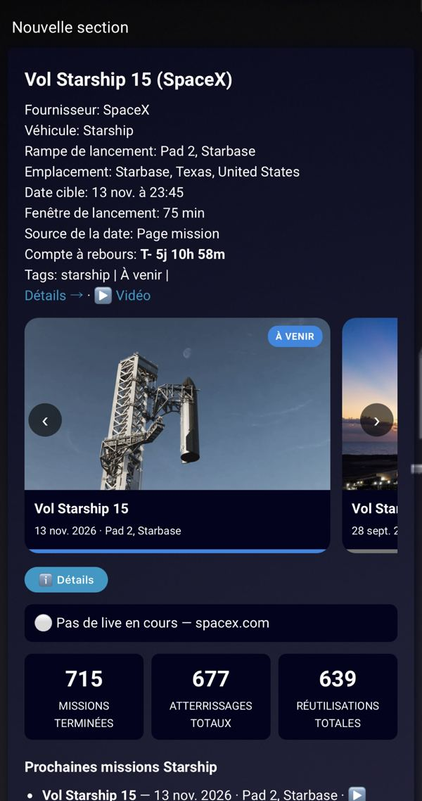 | 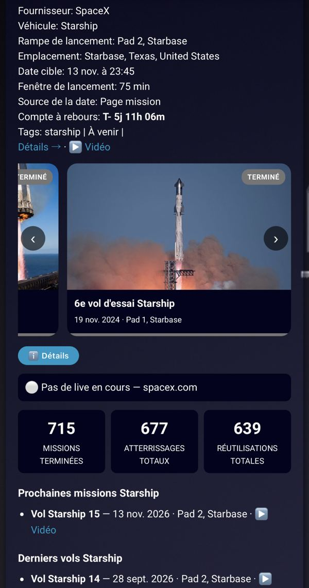 | 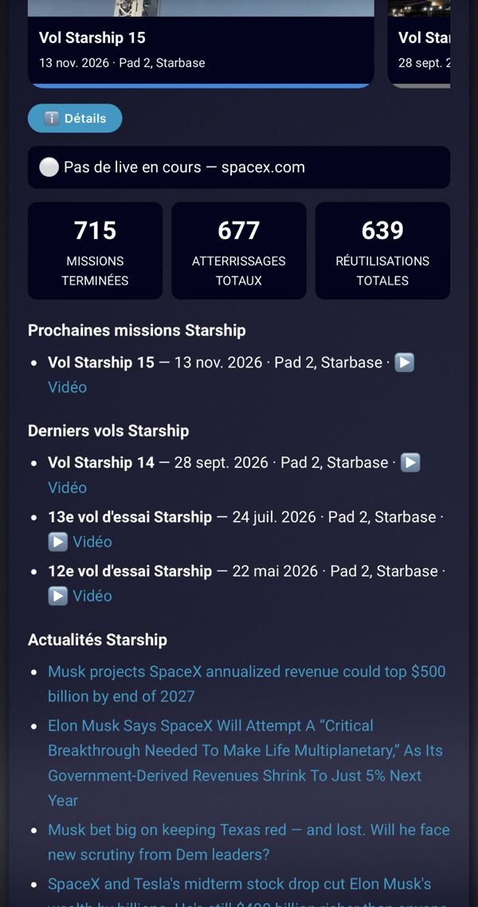 | 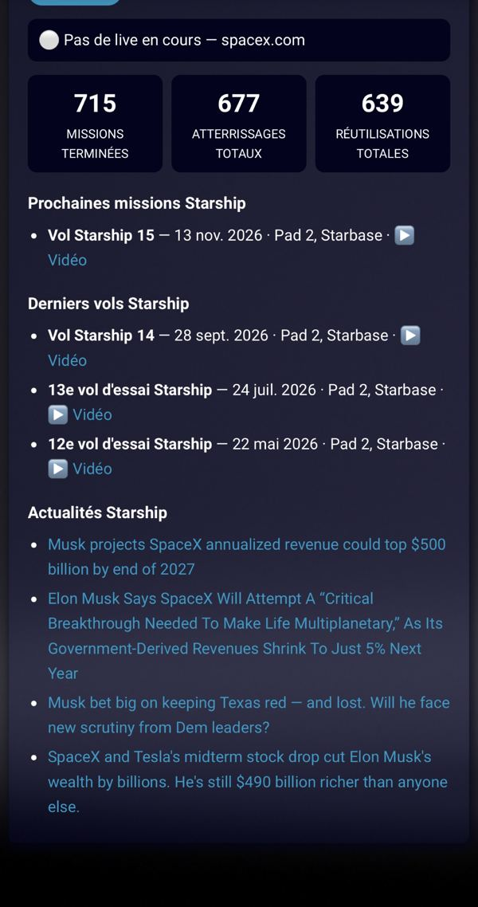 |

### Carte Starship Tracker (v1.26.0)

| Bloc mission | Lives / En direct | Chaînes YouTube | YouTube & stats |
|---|---|---|---|
| 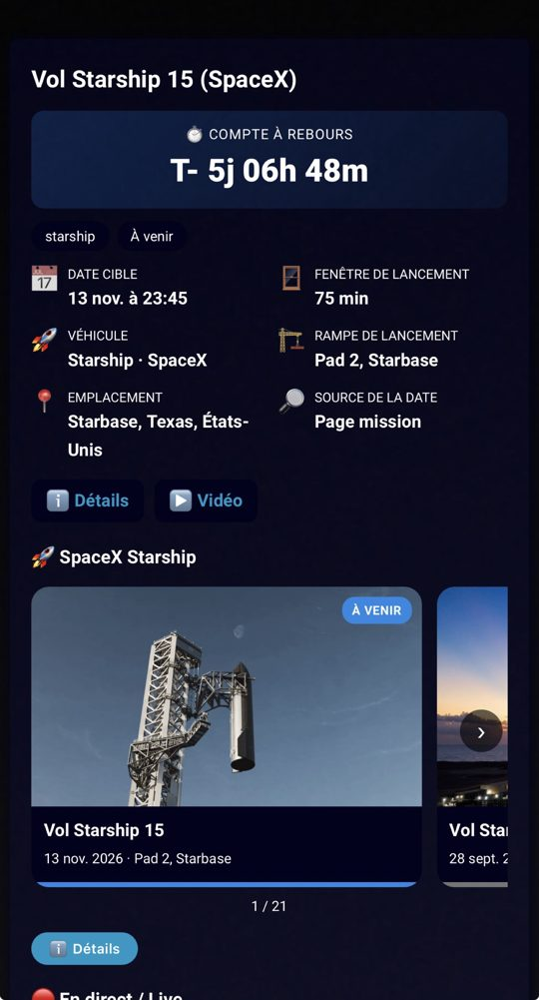 | 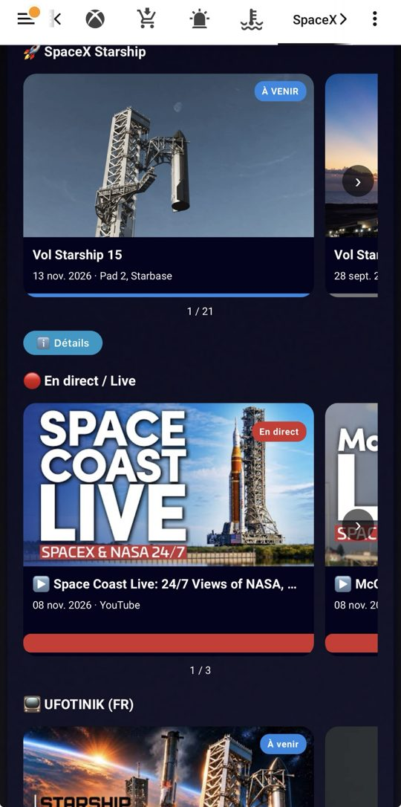 | 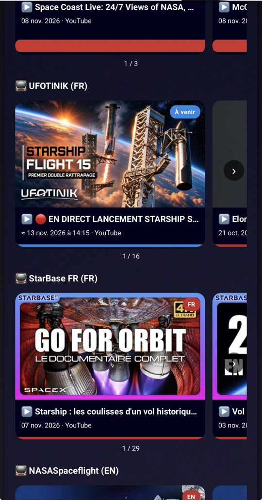 | 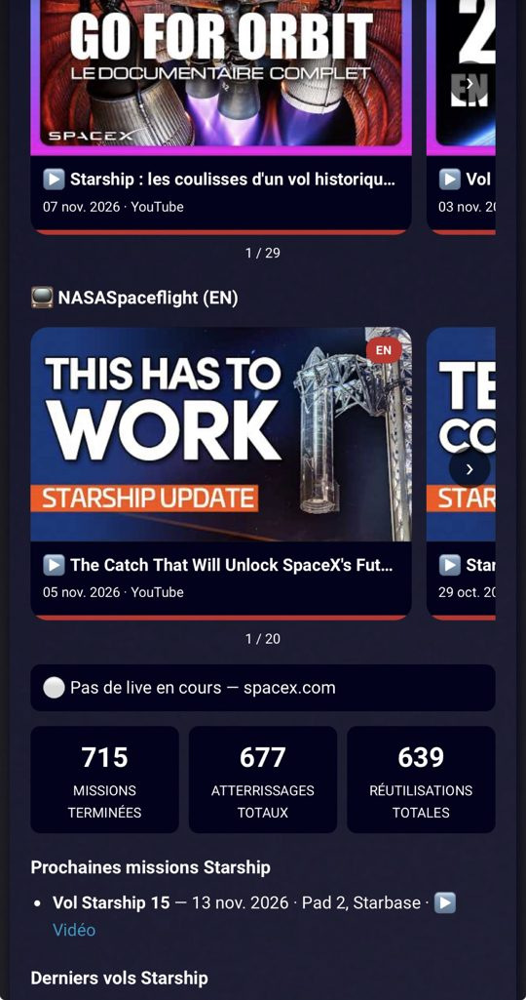 |

| Détails mission | Compte à rebours | Chronologie du vol | Chronologie (suite) |
|---|---|---|---|
| 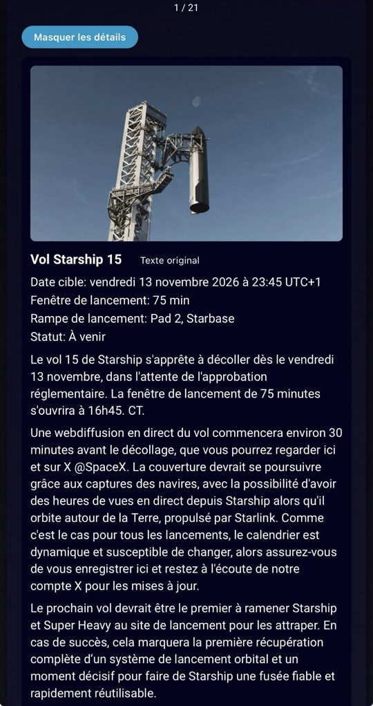 | 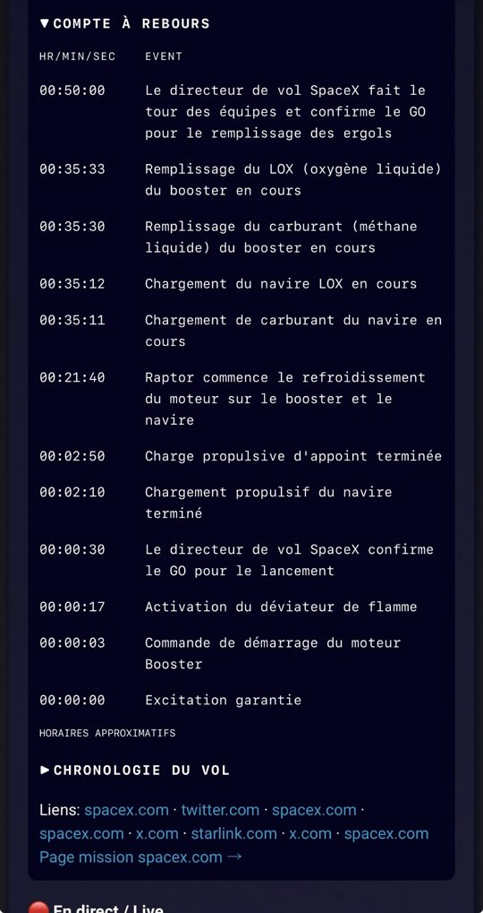 | 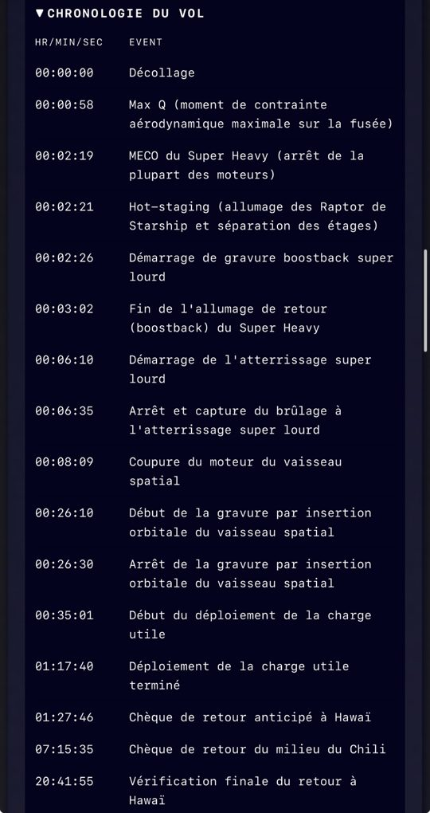 | 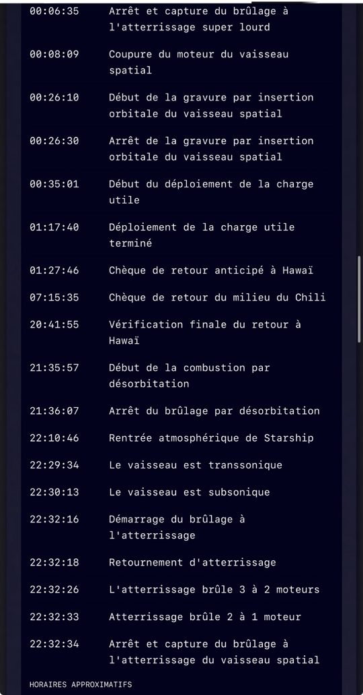 |

📖 Documentation complète : [Wiki](https://github.com/XAV59213/starship_tracker/wiki)

## Via HACS (recommandé)

[](https://my.home-assistant.io/redirect/hacs_repository/?owner=XAV59213&repository=starship_tracker&category=integration)

[](https://my.home-assistant.io/redirect/config_flow_start/?domain=starship_tracker)


Intégration Home Assistant (HACS) qui expose :

- **Starship en direct** (*Starship live*, `binary_sensor`) : `on` quand une mission Starship est en direct sur spacex.com, `off` sinon. Attributs : `url` (page de la mission, où se trouve le live), `vehicle_url`, `mission`, `mission_status`, `launch_date`, `launch_site`, `last_check`. Vérifié toutes les 5 minutes, sans clé.
- **Prochaine mission Starship** (*Next Starship mission*, `sensor`) : état = nom de la prochaine mission Starship annoncée (vide/`unknown` s'il n'y en a pas). Attributs : `mission`, `launch_date`, `launch_time`, `launch_site`, `mission_status`, `vehicle`, `mission_type`, `url`, `date_source` (`feed` ou `mission_page`), `launch_window_minutes`, `last_check`. Même flux et même rafraîchissement (5 min) que le binary_sensor live. Si `launchDate`, `launchTime` et `endDate` sont vides, la date est lue sur la page mission (cache 30 min) ; les valeurs du flux restent prioritaires.
- **Compte à rebours lancement Starship** (*Starship launch countdown*, `sensor`, `device_class: timestamp`) : état = date/heure UTC du prochain lancement Starship (HA affiche « dans 3 jours »…). Attributs : `mission`, `launch_site`, `url`, `seconds_remaining`, `countdown` (ex. `3d 04h 12m`), `launched`, `date_source`, `launch_window_minutes`, `last_check`. `unknown` seulement si ni le flux ni la page mission n'annoncent de date.
- **Statut mission Starship** (*Starship mission status*, `sensor`) : `live` pendant un direct, sinon le statut SpaceX de la prochaine mission (`missionStatus`, ex. *Upcoming*, *Scrubbed*). Attributs : `mission`, `is_live`, `launch_date`, `url`, `last_check`.
- **Dernier vol Starship** (*Last Starship flight*, `sensor`) : nom du dernier vol Starship terminé d'après <https://www.spacex.com/launches> (ex. *Starship Flight 14*). Attributs : `launch_date`, `launch_time`, `launch_time_utc`, `launch_site`, `return_site`, `mission_status`, `url`.
- **Compteurs SpaceX** (`sensor` ×3) : *SpaceX missions terminées*, *SpaceX atterrissages totaux*, *SpaceX réutilisations totales* — les compteurs de <https://www.spacex.com/launches> (API `content.spacex.com/api/spacex-website/launches-page-stats`, lue toutes les heures). Option carte `show_stats: true`.
- **Missions Starship** (*Starship missions*, `sensor`) : nombre de vols Starship listés sur <https://www.spacex.com/launches>. Attributs : `past` (10 derniers vols), `upcoming`, `past_count`, `upcoming_count` — chaque mission : `mission`, `launch_date`, `launch_time`, `launch_site`, `mission_status`, `url`, `video_url` (webcast live / replay cliquable), `is_live`, `date_source`, `launch_window_minutes`.
- **Page du vaisseau Starship** (*Starship vehicle page*) : lien vers <https://www.spacex.com/vehicles/starship>, attribut `url`.
- **Actualités Starship** (*Starship news*) : nombre d'articles récents, avec les 5 dernières actualités Starship (`title`, `link`, `published`) dans l'attribut `news`. Rafraîchi toutes les 30 minutes via [NewsAPI](https://newsapi.org).

- **Rafraîchir** (*Refresh*, `button`, catégorie diagnostic) : force la mise à jour immédiate du live SpaceX et des actualités (utilisable en automatisation via `button.press`).

Version actuelle : **1.29.0**. Nécessite Home Assistant **2024.11.0** ou plus récent. Interface traduite en anglais et en français.

## Installation (HACS)

1. HACS → Intégrations → menu ⋮ → *Dépôts personnalisés* → ajouter `https://github.com/XAV59213/starship_tracker` (catégorie *Intégration*).
2. Installer **Starship Tracker**, puis redémarrer Home Assistant.

## Configuration

1. Créer une clé gratuite sur <https://newsapi.org/register>.
2. Paramètres → Appareils et services → *Ajouter une intégration* → **Starship Tracker**.
3. Coller la clé NewsAPI. Pour la changer plus tard : *Paramètres → Appareils et services → Starship Tracker → Configurer* (la clé est testée puis l’intégration rechargée). Elle est validée puis stockée dans la config entry Home Assistant (jamais dans le code).

### Paramètres d'installation / Installation parameters

| Paramètre | Description |
|---|---|
| Clé NewsAPI (`api_key`) | Clé gratuite [newsapi.org](https://newsapi.org/register), utilisée seulement pour le capteur d'actualités. Testée avant la création de l'entrée. |

### Paramètres de configuration

- **Options** (Paramètres → Appareils et services → Starship Tracker → Configurer) : changer la clé NewsAPI.
- **Reconfigurer** : même chose depuis le menu ⋮ de l'entrée.
- **Réauthentification** : si NewsAPI refuse la clé (401), Home Assistant affiche « Réauthentification requise » pour saisir une nouvelle clé.

### Suppression / Removal

1. Paramètres → Appareils et services → Starship Tracker → ⋮ → **Supprimer**.
2. HACS → Starship Tracker → **Supprimer**, puis redémarrer Home Assistant.
3. Retirer la carte `custom:starship-tracker-card` de vos tableaux de bord.

### Qualité / Quality scale

Niveau **Platinum** de l'[Integration Quality Scale](https://developers.home-assistant.io/docs/core/integration-quality-scale/) : voir [`quality_scale.yaml`](custom_components/starship_tracker/quality_scale.yaml). Tests : `pytest` (pytest-homeassistant-custom-component), couverture ~96 %.

### Dépannage / Troubleshooting

- **HACS bloqué / « [object Object] »** : redémarre Home Assistant puis « Retélécharger » dans HACS.
- **Carte non mise à jour** : vide le cache du navigateur (ou de l'app compagnon) après une mise à jour.
- **Capteur indisponible** : spacex.com, NewsAPI ou YouTube injoignable ; le message traduit est dans le journal, les autres sources continuent.
- **Chaîne YouTube refusée** : colle l'ID `UC…` de la chaîne ; voir le flux `https://www.youtube.com/feeds/videos.xml?channel_id=UC…`.
- **Carrousel NASASpaceflight absent** : en mode `auto`, seules les chaînes de la langue de HA s'affichent ; choisir `both`.
- **Page véhicule** : ce capteur est désactivé par défaut ; l'activer dans Paramètres › Entités si besoin.
- **Diagnostics** : Appareil Starship Tracker › Télécharger les diagnostics (clé NewsAPI masquée).

Plus de détails : [wiki Dépannage](https://github.com/XAV59213/starship_tracker/wiki/Depannage).

## ⚠️ Sécurité

Les versions ≤ 1.0.3 contenaient une clé NewsAPI en clair dans `const.py`. Cette clé est publique dans l'historique Git : **elle doit être révoquée/régénérée** sur le compte NewsAPI. Depuis la 1.1.0, aucune clé n'est livrée avec l'intégration.

## Détection du live

Choix d'un `binary_sensor` (état on/off idiomatique dans HA).

La source est le site officiel SpaceX (<https://www.spacex.com/vehicles/starship> et ses pages de lancement). L'intégration lit le flux JSON public qui alimente la page des lancements du site (`content.spacex.com/api/spacex-website/launches-page-tiles/upcoming`), garde les missions dont `vehicle` vaut `Starship`, et passe à `on` si l'une d'elles a `isLive: true`. Sans live, les attributs décrivent la prochaine mission Starship annoncée, s'il y en a une.

### Sources (1.9.0)

1. Flux principal, toutes les 5 min : `launches-page-tiles/upcoming` (live + prochaine mission).
2. Flux complet de la page <https://www.spacex.com/launches> (`content.spacex.com/api/spacex-website/launches-page-tiles`, ~3 Mo, tous les vols passés et à venir), lu toutes les 6 h et mis en cache : dernier vol Starship, missions Starship à venir/en cours absentes du flux principal.
3. Repli : si le flux principal échoue, le flux complet est relu immédiatement ; si les deux échouent, les entités passent indisponibles.
4. Page mission (1.12.0), au plus toutes les 30 min, seulement si `launchDate`, `launchTime` et `endDate` sont vides : `https://content.spacex.com/api/spacex-website/missions/{link}` (`link` de la tuile, ex. `starship-flight-15`). La date est extraite de la prose (`paragraphs`) : mois et jour, année optionnelle (prochaine occurrence), heure `h:mm a.m./p.m.` avec fuseau CT/CDT/CST, ET, PT ou UTC (converti via `zoneinfo`, ex. `America/Chicago`), fenêtre `N-minute`. L'instant UTC alimente `launch_date`, `launch_time`, le compte à rebours et la carte. `date_source` vaut `mission_page`, ou `feed` quand le flux a déjà une date. `launch_window_minutes` est la durée de la fenêtre. Une date présente dans le flux n'est jamais écrasée.

## Notifications (événements)

Quand le live Starship commence, l'intégration déclenche l'événement Home Assistant `starship_tracker_live_started`, et `starship_tracker_live_ended` quand il se termine. Données : `mission`, `url`, `launch_date`, `launch_site`, `mission_status`. `starship_tracker_launch_soon` est émis une seule fois par mission/date quand le lancement est à moins d'1 h (T-1h, précision 5 min). Données : `mission`, `url`, `launch_time`, `minutes_remaining`, `launch_site`, `mission_status`. Aucun événement live n'est émis au démarrage de Home Assistant, seulement lors d'un changement d'état.

Exemple d'automatisation (remplacer `notify.mobile_app_mon_telephone` par votre service de notification) :

```yaml
automation:
  - alias: "Starship en direct"
    triggers:
      - trigger: event
        event_type: starship_tracker_live_started
    actions:
      - action: notify.mobile_app_mon_telephone
        data:
          title: "🚀 Starship en direct"
          message: "{{ trigger.event.data.mission }} est en live sur spacex.com"
          data:
            url: "{{ trigger.event.data.url }}"
            clickAction: "{{ trigger.event.data.url }}"
```

Variante sans événement : déclencher sur l'état du binary_sensor (`trigger: state`, `to: "on"`).

## YouTube FR / EN (à partir de 1.16.0)

Dans **Configurer**, les ID UC des chaînes proposées sont préremplis (les @pseudos restent acceptés et sont convertis localement pour ces trois chaînes). Les chaînes proposées par défaut sont **[@UFOTINIK](https://www.youtube.com/@UFOTINIK)** pour le français et **[@NASASpaceflight](https://www.youtube.com/@NASASpaceflight)** pour l’anglais. Enregistrez pour les activer ; vous pouvez les changer ou les vider. Le même filtre `starship` s’applique aux deux chaînes FR et EN et reste activé par défaut (NSF publie aussi sur d’autres sujets). Les Shorts présents dans RSS sont inclus s’ils correspondent au filtre.

Renseignez une chaîne française (`youtube_channel_fr`), une chaîne anglaise/américaine (`youtube_channel_en`), ou les deux. Les mêmes champs facultatifs sont proposés à l'installation.

- Formats : `https://www.youtube.com/@nom`, `@nom`, `https://www.youtube.com/channel/UC…` ou ID `UC…`. L'URL / le pseudo est résolu une fois en ID lors de l'enregistrement. Si YouTube bloque la résolution, utilisez directement l'ID UC de la chaîne.
- `youtube_keyword` : filtre sur le **titre**, sans distinction de casse, `starship` par défaut. Vide = toutes les vidéos. Videz une chaîne pour la désactiver. FR et EN désignent vos choix de chaînes : aucune détection ni traduction automatique de la langue des vidéos.
- Pas de connexion YouTube, pas de clé API. Flux public `https://www.youtube.com/feeds/videos.xml?channel_id=ID`, toutes les **10 min**. Seules les publications récentes présentes dans le flux sont accessibles : une vidéo déjà sortie du flux pendant une longue interruption peut être manquée. Ce n'est pas une détection fiable du début d'un direct ; une première peut apparaître avant sa diffusion.
- Entités créées uniquement pour les chaînes configurées : `sensor.starship_tracker_youtube_fr` / `sensor.starship_tracker_youtube_en`. État = dernier titre correspondant (255 caractères max), attributs `title` (complet), `url`, `published` (ISO 8601 avec fuseau), `thumbnail`, `channel` (ID UC), `video_id`. Sans correspondance : état inconnu. En cas d'échec réseau : seule l'entité de la chaîne concernée devient indisponible.
- Carte : bloc **📺 Vidéos YouTube**, liens FR / EN ; option `show_youtube: true` par défaut. La dernière vidéo de chaque langue choisie apparaît aussi en tête du carrousel (miniature, titre original, date, badge FR/EN). Un clic ouvre YouTube, pas les détails de mission. `youtube_carousel_lang: auto` sélectionne FR si l’interface HA est française, sinon EN ; valeurs possibles `auto`, `fr`, `en`, `both`. `lang: fr` dans la carte peut forcer la langue de son interface. `carousel_count` limite le total des vignettes, vidéos comprises ; le compteur les inclut. `show_youtube: false` masque les liens et les vignettes ; `show_carousel: false` masque seulement le carrousel. Les champs `youtube_fr` / `youtube_en` permettent de choisir une entité renommée si nécessaire. Le titre original de la vidéo est conservé.
- Événement `starship_tracker_youtube_video` : `language` (`fr` / `en`), `title`, `url`, `channel`, `published`. La première lecture établit un historique silencieux ; les identifiants vus sont conservés dans le stockage Home Assistant, donc aucun doublon au redémarrage. Un changement de chaîne ou de filtre crée un nouvel historique silencieux.
- Événement `starship_tracker_youtube_live` : `status` (`upcoming` / `live`), `scheduled`, `title`, `url`, `channel`, `language`. Émis une seule fois par vidéo et par état (persistant).

### Résolution YouTube / consentement européen (1.16.1)

Les trois chaînes suggérées sont reconnues sans accès réseau, que vous colliez leur @pseudo ou leur URL avec @pseudo. Vous pouvez aussi coller directement leur ID :

| Chaîne | ID public accepté sans test réseau |
|---|---|
| UFOTINIK | `UCmzE9RqR_6_F6ib_yirMn2Q` |
| NASASpaceflight | `UCSUu1lih2RifWkKtDOJdsBA` |
| StarBase FR | `UCLg3UuuZ8_gn9Z3XyrzDKhg` |

Pour les autres chaînes, l'intégration demande la page publique avec des en-têtes de navigateur et des préférences anonymes de consentement (pas de compte/cookies de connexion). Elle privilégie l'URL canonique, puis `externalId` et les balises meta de chaîne ; les identifiants des chaînes recommandées sont ignorés. Si la résolution dépasse 15 secondes ou si YouTube affiche toujours un écran de consentement, utilisez directement un ID UC. Le flux RSS n'est pas testé lors de l'enregistrement ; une panne ou lenteur du flux ne bloque pas la configuration. Si un mauvais ID avait déjà été enregistré, remplacez-le manuellement dans **Configurer** : les chaînes personnalisées ne sont jamais écrasées automatiquement.

### Suivi du projet StarBase FR (facultatif)

Une deuxième chaîne française est disponible sans remplacer UFOTINIK : **@StarBaseFR**, pour le suivi du projet Starship / Starbase.

- Activez **« Activer le suivi du projet StarBase FR »** (`youtube_starbase_fr`, **désactivé par défaut**).
- `youtube_channel_fr2` propose l’ID UC de `@StarBaseFR` ; vous pouvez la changer (URL, @pseudo ou ID UC) ou vider le champ. L'ID est résolu uniquement à l'activation ; aucune requête RSS n'est faite tant que l'option reste désactivée. Désactiver l'option conserve l'ID déjà enregistré.
- **« Appliquer aussi le filtre de titre à StarBase FR »** (`youtube_starbase_filter`) est **désactivé par défaut** : toutes ses publications RSS sont suivies, même si le titre ne contient pas « Starship ». Si activé, le même `youtube_keyword` que les chaînes principales est utilisé. UFOTINIK et NASASpaceflight gardent leur filtre `starship` par défaut.
- Entité : `sensor.starship_tracker_youtube_fr_starbase`, même état et attributs que les autres capteurs. Événement identique avec `language: fr` et son ID dans `channel` : l'automatisation FR ci-dessous couvre les deux chaînes. Pour les distinguer, filtrez aussi `event_data.channel`.
- Carte : lien **FR · StarBase FR** et vignette avec badge **FR**. En mode automatique elle apparaît si HA est en français ; `youtube_carousel_lang: both` affiche les trois sources configurées. Première lecture silencieuse et historique persistant indépendant.

### Notification par langue

Copiez cet exemple dans l'éditeur YAML d'une automatisation et remplacez le service de notification. Pour les anglophones, dupliquez-le en remplaçant `language: fr` par `language: en` (et le titre). Aucun message n'est envoyé sans votre automatisation.

```yaml
# Configuration > Automatisations > Créer > Modifier en YAML.
# FR: remplacer le service notify par celui du téléphone. EN: replace notify service.
# Pour l'anglais / For English: change language: fr to language: en.
alias: "Starship - vidéo YouTube FR"
triggers:
  - trigger: event
    event_type: starship_tracker_youtube_video
    event_data:
      language: fr
actions:
  - action: notify.mobile_app_mon_telephone
    data:
      title: "📺 Starship — YouTube FR"
      message: "{{ trigger.event.data.title }}"
      data:
        url: "{{ trigger.event.data.url }}"
        clickAction: "{{ trigger.event.data.url }}"
mode: queued
max: 20
```

Fichier prêt à copier : [`docs/youtube-notifications.yaml`](docs/youtube-notifications.yaml).

## Diagnostics & robustesse

- *Paramètres → Appareils et services → Starship Tracker → ⋮ → Télécharger les diagnostics* : état du live et des actualités, clé NewsAPI masquée (`**REDACTED**`).
- Si NewsAPI échoue au démarrage (clé invalide, quota, réseau), l'intégration démarre quand même : le live et la prochaine mission fonctionnent, seul le sensor actualités est indisponible jusqu'au prochain rafraîchissement.

## Limites

- Le flux JSON est interne au site spacex.com, pas une API documentée : il peut changer sans préavis.
- Le statut dépend de la mise à jour du flag `isLive` par SpaceX, et du délai de 5 minutes entre deux vérifications.

## Brand / Icônes

Les icônes et logos de l'intégration sont dans `custom_components/starship_tracker/brand/`
(`icon.png`, `icon@2x.png`, `dark_icon*.png`, `logo*.png`, `dark_logo*.png`, PNG transparents).
Home Assistant (2026.3+) les utilise directement pour les intégrations personnalisées.

Integration icons and logos live in `custom_components/starship_tracker/brand/` (transparent PNGs),
used directly by Home Assistant for custom integrations.

## Carte Starship Tracker (custom card)

**1.29.0** : nouveau bloc « 🛂 Autorisations avant décollage » sous le bloc mission (option `show_authorizations`) et capteur `sensor.starship_tracker_launch_authorizations` (Prêt / Partiel / En attente, liste en attribut `items`) : NOTAM « opérations spatiales » de Starbase (FAA TFR, toutes les 30 min), avis aux navigateurs NGA (NAVAREA IV), fermetures Highway 4 / plage du comté de Cameron, et licence FAA « à vérifier » avec lien (non publiée en ligne de façon lisible). Sources publiques, sans clé, jamais bloquantes. EN: new pre-launch approvals block (FAA NOTAM, NGA warnings, Highway 4 closures, FAA license link) and `launch_authorizations` sensor.

**1.28.0** : la case « Véhicule » affiche le numéro du booster et du vaisseau (ex. Super Heavy B22 · Ship S42), lus sur Launch Library 2 (thespacedevs) une fois par heure ; attributs `booster` et `ship` sur la prochaine mission. EN: booster and ship serials in the Vehicle cell.

**1.27.2** : la page ne remonte plus en haut quand la carte se met à jour (hauteur conservée pendant le rafraîchissement). EN: the page no longer jumps to the top when the card refreshes.

**1.26.1** : capteurs YouTube de nouveau disponibles quand le flux RSS YouTube répond 404 (repli sur les onglets Vidéos/Lives des chaînes). EN: YouTube sensors fall back to channel tabs when YouTube RSS is down.

**1.26.0** : bloc mission repensé (grand compte à rebours, grille avec icônes, tags en pastilles, boutons Détails/Vidéo, emplacement traduit). EN: redesigned mission block.

**1.25.0** : nouveau carrousel « 🔴 En direct » en tête des carrousels YouTube, qui regroupe les vidéos en direct (y compris les flux 24/7 NASASpaceflight) ; désactivable avec `show_carousel_live: false`. EN: dedicated live carousel.

**1.24.1** : tests sur de vraies pages YouTube enregistrées (UFOTINIK, StarBase FR, NASASpaceflight) pour détecter un changement de format, wiki en anglais. EN: recorded YouTube page tests, English wiki.

**1.24.0** : Quality Scale **Platinum** (typage strict `mypy --strict` en CI, `py.typed`), indicateur « ≈ » conservé à la fusion des vidéos. EN: Platinum quality scale (strict typing).

**1.23.1** : badges Quality Scale Gold et Wiki, wiki mis à jour (carrousels, live, Gold). EN: Gold and wiki badges, wiki refreshed.

**1.23.0** : le carrousel NASASpaceflight s'affiche toujours, quelle que soit la langue, avec badges live activés par défaut (`youtube_live_badges_en: false` pour les retirer). EN: NASASpaceflight carousel always shown, live badges on by default.

**1.22.0** : carrousels UFOTINIK, StarBase FR et NASASpaceflight affichés par défaut (`youtube_carousel_lang: both`), nombre de vidéos par chaîne réglable (`youtube_count_youtube_fr`, `youtube_count_youtube_fr_starbase`, `youtube_count_youtube_en`, 0 = toutes, jusqu'à 50 vidéos Starship par chaîne). EN: all three YouTube carousels shown by default, per-channel video count (0 = all, up to 50).

**1.21.0** : lives filtrés sur « starship » aussi, heure estimée marquée « ≈ », événement `starship_tracker_youtube_live` (`status` `upcoming`/`live`, `scheduled`, `title`, `url`, `channel`, `language`) une fois par état, option `youtube_live_badges_en` pour NASASpaceflight, parseur YouTube séparé (`youtube_parser.py`).

**1.20.0** : carrousels UFOTINIK et StarBase FR, badges « À venir » (avec date/heure), « En direct » et « Terminé » pour les lives.

**1.19.1** : un échec des onglets YouTube `/videos` et `/streams` ne rend plus le capteur RSS indisponible (tests corrigés).

**1.19.0** : Quality Scale **Gold** : icônes dans `icons.json`, messages d'erreur traduits (FR/EN), capteur « page véhicule » désactivé par défaut, section Dépannage.

**1.18.0** : les carrousels YouTube montrent les 15 dernières vidéos Starship de chaque chaîne, pas seulement celles parmi les 15 derniers uploads : en plus du flux RSS, lecture des onglets publics Vidéos et En direct (sans clé API, date estimée pour les plus anciennes). Les notifications restent basées sur le RSS.

**1.17.2** : le détail de la mission Starship s'affiche juste sous le carrousel SpaceX, avant les carrousels YouTube.

**1.17.1** : le carrousel SpaceX affiche toutes les missions Starship ; `carousel_count` ne limite plus que les carrousels YouTube.

**1.17.0** : la carte affiche 4 carrousels séparés : 🚀 SpaceX Starship, 📺 UFOTINIK (FR), 📺 StarBase FR (FR), 📺 NASASpaceflight (EN), chacun avec les 15 dernières vidéos Starship (attribut `videos` des capteurs YouTube). `youtube_carousel_lang` filtre toujours les carrousels YouTube affichés ; options `show_carousel_spacex`, `show_carousel_youtube_fr`, `show_carousel_youtube_fr_starbase`, `show_carousel_youtube_en` pour masquer chacun ; `carousel_count` s'applique par carrousel.

**1.16.1** : résolution YouTube corrigée en Europe : User-Agent navigateur, langue et préférences anonymes de consentement ; priorité à l'URL canonique de chaîne, puis `externalId` / métadonnées explicites, jamais aux `channelId` de vidéos recommandées. IDs vérifiés préremplis et conversion locale des trois @pseudos suggérés ; acceptation des IDs sans test RSS. Délai de 15 secondes et erreur de résolution explicite pour les autres chaînes.

**1.16.0** : chaînes YouTube FR et EN facultatives (URL, @pseudo ou ID UC…), filtre de titre `starship` personnalisable, flux RSS sans clé toutes les 10 minutes, capteurs, liens et vignettes YouTube dans le carrousel (langue automatique ou `youtube_carousel_lang: auto|fr|en|both`, `show_youtube: true`). Événement `starship_tracker_youtube_video` pour les nouvelles vidéos seulement, historique persistant sans réalerte au redémarrage. Pas de notification lors de la première lecture ou après changement de chaîne/filtre.

**1.15.1** : exemple YAML corrigé (`carousel_count: 25` au lieu de 10). Si votre carte conserve `carousel_count: 10`, passez-le à 25 pour voir les 21 missions ; une mise à jour ne remplace pas votre configuration. Carrousel mobile : flèches précises (une vignette par clic), masquées aux extrémités ; compteur de position ; position conservée lors des mises à jour.

**1.15.0** : contenu SpaceX en français (option « Traduire le contenu SpaceX en français », activée par défaut si HA est en français) : statuts (Terminé / À venir / En direct), titres (« Starship's Seventh Flight Test » → « 7e vol d'essai Starship », « Starship Flight 15 » → « Vol Starship 15 »), dictionnaire intégré pour le compte à rebours et la chronologie (Décollage, Max Q, MECO, hot-staging, boostback, capture…), description et termes inconnus traduits automatiquement via un service gratuit sans clé (translate.googleapis.com, repli MyMemory) avec cache persistant ; en cas d'échec le texte original reste affiché. Bouton « Texte original » dans le panneau Détails. Attributs `mission_fr`, `mission_status_fr`, `mission_description_fr`, `mission_countdown_fr`, `mission_timeline_fr`. Limite : ces services gratuits ne sont pas garantis (quota / blocage) et la description des vols passés reste en anglais. Quality Scale **Silver** (`quality_scale.yaml`) : réauthentification NewsAPI, reconfiguration, `PARALLEL_UPDATES`, exception traduite du bouton, descriptions des champs, tests HA (config flow 100 %, ~96 % au total) + workflow Tests ; HACS : validation sans `ignore`, description et topics du dépôt.

**1.14.0** : tous les vols Starship (21 : SN5 → Flight 15) dans le carrousel et la liste (`carousel_count` par défaut 25) ; vignettes à taille fixe (image `` 16/9, plus de vignette vide sur mobile, 1 vignette ≈ 82 % de largeur) ; panneau Détails : vidéo (YouTube intégré, sinon bouton ▶ vers le direct/replay X), image du plan de vol (infographie), sections repliables COMPTE À REBOURS et CHRONOLOGIE DU VOL en police monospace. Nouveaux attributs prochaine mission : `mission_videos`, `mission_infographic(_mobile)`, `mission_countdown`, `mission_timeline`. Pour les vols passés, la carte lit la page mission à la demande (cache 6 h).

**1.13.1** : correction de la page qui « saute » sur la carte : la carte ne se redessine plus à chaque mise à jour de Home Assistant (seulement si une entité Starship change), le compte à rebours est mis à jour en place, l'image du panneau Détails réserve sa place (16/9), état du panneau et défilement du carrousel conservés.

**1.13.0** : bouton « Détails » sur la carte (option `show_details_button`, affiché par défaut) qui déplie la photo de la mission, la date/heure locale, la fenêtre, la rampe, le statut, la description et les liens (webcast, page spacex.com). La page mission de la prochaine mission est toujours lue (cache 30 min) ; carrousel d'images (`show_carousel`, `carousel_count`) des missions Starship à venir et passées avec badge À VENIR / DIRECT / TERMINÉ ; un clic ouvre le panneau Détails de la mission ; attribut `image` dans les listes du capteur missions (images du flux /launches, sans requête en plus) ; nouveaux attributs du capteur prochaine mission : `mission_image` (URL absolue), `mission_description` (texte, 1500 caractères max), `mission_url`, `mission_links`, `webcast_links`.

**1.12.0** : date cible et compte à rebours lorsque le flux SpaceX n'a pas de date (Starship Flight 15). La page mission est mise en cache 30 min et la prose est convertie en UTC — « Friday, November 13 », fenêtre de 75 minutes ouvrant à 4:45 p.m. CT → `2026-11-13T22:45:00Z`. La carte lit l'état timestamp du compte à rebours (repli : `launch_date` + `launch_time`) et affiche la fenêtre (`launch_window_minutes`) ainsi que la source (`date_source` : Flux / Page mission, Feed / Mission page).

**1.11.0** : compteurs SpaceX (missions terminées / atterrissages / réutilisations) en sensors et sur la carte (`show_stats`, réglable dans l’éditeur visuel).

**1.10.0** : la carte affiche les prochaines missions et les derniers vols Starship avec un lien **▶ Vidéo** cliquable (options `show_missions: true`, `missions_count: 3`).

Depuis la 1.8.0, une carte Lovelace personnalisée est **livrée avec l'intégration** : aucune installation HACS séparée, aucune ressource à ajouter. Elle est chargée automatiquement dès que l'intégration est configurée (vider le cache du navigateur / de l'app après la mise à jour si elle n'apparaît pas).

1. Mettre à jour Starship Tracker en 1.8.0 via HACS, redémarrer Home Assistant.
2. Tableau de bord → Modifier → Ajouter une carte → chercher **Starship Tracker** (ou carte manuelle) :

```yaml
type: custom:starship-tracker-card
```

Affiche la prochaine mission façon fiche (titre « Mission (SpaceX) », fournisseur, véhicule, rampe, emplacement, date cible, compte à rebours en direct, tags), le statut live et les 5 dernières actualités. Textes en français ou anglais selon la langue de HA. Les entités sont détectées automatiquement. **Toutes les options se règlent dans l’éditeur visuel** (Modifier la carte) ou en YAML :

```yaml
type: custom:starship-tracker-card
title: ""            # titre perso (vide = nom de la mission)
show_details: true   # fiche mission (fournisseur, véhicule, rampe, date, tags)
show_carousel: true   # carrousel d'images des missions (à venir + passées), flèches, badges
carousel_count: 25    # nombre max de vignettes
show_details_button: true   # bouton « Détails » : photo, date locale, fenêtre, rampe, statut, description, liens
show_countdown: true # compte à rebours
show_live: true      # bandeau live
show_videos: true    # liens vidéo cliquables
show_stats: true     # compteurs SpaceX
show_missions: true  # suivi des missions Starship
missions_count: 3    # missions par liste
show_upcoming: true  # prochaines missions
show_last: true      # derniers vols
show_news: true      # afficher les actualités
news_count: 5        # nombre d'actualités
# entités à forcer si besoin : live, next, countdown, status, missions, news
# next: sensor.starship_tracker_prochaine_mission_starship
```

*EN* — Since 1.8.0 a custom card ships **with the integration** (no separate HACS install, no resource to add). Add a card of type `custom:starship-tracker-card`; entities are auto-detected.

## Carte Lovelace / Lovelace card (cartes natives)

Exemple prêt à coller (Tableau de bord → Modifier → Ajouter une carte → Manuel), aussi dans [`docs/lovelace-card.yaml`](https://github.com/XAV59213/starship_tracker/blob/main/docs/lovelace-card.yaml).
Met en avant la **prochaine mission Starship** façon fiche mission (titre « Mission (SpaceX) », Provider / Vehicle / Launch Pad / Location / Target Date / Countdown / Tags), puis le statut live et les 5 dernières actualités. Cartes natives uniquement.

Ready-to-paste example (Dashboard → Edit → Add card → Manual), also in `docs/lovelace-card.yaml`. Native cards only.

> Les `entity_id` ci-dessous correspondent à une installation en anglais. En français ils peuvent être par ex. `sensor.starship_tracker_prochaine_mission_starship` — vérifiez dans Paramètres → Entités.

```yaml
# Starship Tracker — carte Lovelace / Lovelace card
# Style « fiche mission » (titre « Mission (Provider) » + lignes), cartes natives uniquement.
# Adaptez les entity_id si votre HA est en français (voir README).
type: vertical-stack
cards:
  # 1) Prochaine mission Starship (mise en avant)
  - type: markdown
    content: >
      
      
      
      ## {{ states(m) }} (SpaceX)

      **Provider:** SpaceX<br>
      **Vehicle:** {{ state_attr(m, 'vehicle') or 'Starship' }}<br>
      **Launch Pad:** {{ state_attr(m, 'launch_site') or 'Starbase' }}<br>
      **Location:** Starbase, Texas, United States<br>
      **Target Date:** {{ state_attr(m, 'launch_date') or 'TBD' }} {{ state_attr(m, 'launch_time') or '' }} · {{ state_attr(m, 'launch_window_minutes') }} min<br>
      **Countdown:** {{ state_attr(c, 'countdown') or '—' }} (lancé / launched)<br>
      **Tags:** {{ state_attr(m, 'mission_type') or 'Test flight' }} | {{ state_attr(m, 'mission_status') or 'Upcoming' }} |

      [Détails / Details]({{ state_attr(m, 'url') }})
      
      ## TBD (SpaceX)

      **Provider:** SpaceX<br>
      **Vehicle:** Starship<br>
      **Launch Pad:** Starbase<br>
      **Location:** Starbase, Texas, United States<br>
      **Target Date:** TBD<br>
      **Tags:** Aucune mission annoncée / No mission announced |
      

  # 2) Statut live
  - type: markdown
    content: >
      
      🔴 **EN DIRECT / LIVE** — [Regarder / Watch]({{ state_attr('sensor.starship_tracker_next_starship_mission', 'url') or 'https://www.spacex.com/vehicles/starship' }})
      
      ⚪ Pas de live en cours / No live stream — [spacex.com/vehicles/starship](https://www.spacex.com/vehicles/starship)
      

  # 3) Actualités
  - type: markdown
    title: Actualités / News
    content: |
      
      
      - [{{ a.title }}]({{ a.link }})
      
      Aucune actualité / No news
      
```

## English

Home Assistant (HACS) integration — **version 1.29.0**, requires Home Assistant **2024.11.0+**, UI in English and French.

### YouTube channels (1.16.0)

Optional **StarBase FR project updates**: enable `youtube_starbase_fr` (off by default), with `youtube_channel_fr2` prefilled with the UC ID of `@StarBaseFR`. Its separate sensor is `sensor.starship_tracker_youtube_fr_starbase`; events use `language: fr` and its own `channel` ID. It appears alongside the main FR channel in French carousel mode (all three sources in `both` mode). No lookup/polling while disabled; disabling preserves the resolved ID. Emptying the field also disables the feed. Its `youtube_starbase_filter` toggle is **off by default**, so all recent channel uploads are included; enable it to apply the common keyword. The primary UFOTINIK / NASASpaceflight channels still default to the `starship` filter. Baseline/persistent deduplication is independent.

In **Configure**, verified UC IDs are prefilled, with offline alias conversion for the three suggested channels. Suggested defaults are **@UFOTINIK** (FR) and **@NASASpaceflight** (EN); save to enable them, change or clear either channel. The default `starship` title filter excludes unrelated NSF uploads. Shorts in RSS are included if they match. Optionally set `youtube_channel_fr` and/or `youtube_channel_en` to a channel URL, @handle or UC… ID. Handles/URLs are resolved once and stored as channel IDs. If resolution is blocked, enter the UC… ID directly. Leave a channel empty to disable it. `youtube_keyword` filters titles case-insensitively (default `starship`; empty = all uploads). FR/EN label your selected channels; video language is not detected or translated.

Public RSS is polled every 10 minutes without a YouTube API key/account. Sensors `sensor.starship_tracker_youtube_fr` and `_youtube_en` expose the latest matching title and `title`, `url`, `published`, `thumbnail`, `channel`, `video_id` attributes. Only configured channels create sensors. The bundled card shows FR/EN links by default (`show_youtube: true`; optional entity overrides `youtube_fr` / `youtube_en`). Latest-video tiles come first in the carousel with thumbnail, original title, date and FR/EN badge; clicking opens YouTube, not mission details. `youtube_carousel_lang: auto` follows the HA/card UI language (French → FR, otherwise EN); overrides: `fr`, `en`, `both`. Optional card `lang: fr` forces French UI. The position counter and `carousel_count` include video tiles. `show_youtube: false` hides both tiles and links; `show_carousel: false` hides the carousel only. A failed channel becomes unavailable without blocking SpaceX or the other language.

`starship_tracker_youtube_video` carries `language`, `title`, `url`, `channel`, `published`. No alerts on the initial baseline or channel/filter changes; seen IDs persist across restarts. RSS only covers recent uploads, so long outages may miss videos. Premiere listings may precede playback; live-start detection is not guaranteed. `starship_tracker_youtube_live` (`status` upcoming/live, `scheduled`, `title`, `url`, `channel`, `language`) fires once per video and state. Card option `youtube_live_badges_en` adds live badges to NASASpaceflight; estimated times show "≈".

Copy [`docs/youtube-notifications.yaml`](docs/youtube-notifications.yaml) into an automation's YAML editor, replace the notification service and use `event_data: {language: en}` for English notifications (`fr` for French). Notifications require your own automation.

- **1.20.0** — UFOTINIK / StarBase FR carousels: Upcoming (with date/time), Live and Ended badges for streams.
- **1.19.1** — YouTube channel tab failures no longer make the RSS sensor unavailable.
- **1.19.0** — Quality Scale **Gold**: `icons.json`, translated update errors (FR/EN), vehicle page sensor disabled by default, troubleshooting section.
- **1.18.0** — YouTube carousels show the last 15 Starship videos per channel: RSS plus public Videos/Live tabs (no API key, estimated dates for older items). Notifications still use RSS only.
- **1.17.2** — Starship mission details now appear right below the SpaceX carousel, before the YouTube carousels.
- **1.17.1** — SpaceX carousel shows all Starship missions; `carousel_count` only limits YouTube carousels.
- **1.17.0** — Card now shows 4 separate carousels (SpaceX Starship, UFOTINIK, StarBase FR, NASASpaceflight), each with the last 15 Starship videos (new `videos` sensor attribute). Per-carousel toggles `show_carousel_spacex`, `show_carousel_youtube_fr`, `show_carousel_youtube_fr_starbase`, `show_carousel_youtube_en`; `carousel_count` is per carousel.
- **1.16.1** — Fixed European YouTube consent handling, browser request headers and anonymous consent preferences, canonical-first channel identification (never recommended-video channelId), offline suggested-handle mapping and UC ID defaults. UC IDs require no RSS/network validation; other resolutions have a 15-second timeout with a clear error. Replace any previously saved incorrect channel ID manually.
- **1.16.0** — Optional French/English YouTube channels, keyless RSS, persistent new-video events, sensors, card links and language-aware thumbnail carousel tiles.
- **1.15.1** — Fixed YAML example (`carousel_count: 25`, previously 10). Existing cards with `carousel_count: 10` must change it to 25 to show all 21 missions; updates preserve user configuration. Mobile carousel: exact one-tile arrow navigation, hidden arrows at the ends, position counter and scroll position preserved across updates.
- **1.15.0** — French translation of SpaceX content (option, on by default when HA is in French): statuses, deterministic titles, built-in timeline dictionary, free keyless machine translation of the description (Google gtx, MyMemory fallback) with persistent cache and original-text fallback; « Texte original » toggle in the card. Free services are best effort. Quality Scale **Silver** (`quality_scale.yaml`): NewsAPI reauth, reconfigure flow, `PARALLEL_UPDATES`, translated button exception, field descriptions, HA tests (config flow 100 %, ~96 % overall) + Tests workflow; HACS validation without ignores, repo description/topics.
- **1.14.0** — all Starship flights (21, SN5 → Flight 15) in the carousel and list (`carousel_count` default 25); fixed-size tiles (no more empty tile on mobile); Details panel: video (YouTube embed or ▶ button to the X webcast), flight-plan infographic, collapsible monospace COUNTDOWN and FLIGHT TIMELINE. New next-mission attributes `mission_videos`, `mission_infographic(_mobile)`, `mission_countdown`, `mission_timeline`; past flights load their mission page on demand in the card (6 h cache).
- **1.13.1** — fix page jumping on the card: re-render only when a Starship entity changes (not on every `hass` update), countdown updated in place, Details image space reserved (16/9), panel state and carousel scroll kept.
- **1.13.0** — card « Details » button (`show_details_button`, on by default) plus an image carousel (`show_carousel`, `carousel_count`) of upcoming + past Starship missions with UPCOMING / LIVE / COMPLETED badges — tap a tile for its details; `image` attribute in the missions lists — expanding the mission image, local date/time, window, pad, status, description and links. The next mission's page is always fetched (30 min cache); new next-mission attributes `mission_image`, `mission_description` (plain text, ≤1500 chars), `mission_url`, `mission_links`, `webcast_links`.
- **1.12.0** — when a Starship tile has null `launchDate`, `launchTime` and `endDate`, the mission-page prose is parsed (cached 30 min) into a UTC timestamp for the countdown and the card. Flight 15: 4:45 p.m. CT on November 13, 2026 → `2026-11-13T22:45:00Z`. New attributes: `date_source` (`feed` / `mission_page`) and `launch_window_minutes`. Feed values still win when present.
- **Starship live** (`binary_sensor`): `on` while a Starship mission is live on spacex.com (checked every 5 min, no key).
- **Next Starship mission** (`sensor`): name of the next announced Starship mission; attributes `launch_date`, `launch_time`, `launch_site`, `mission_status`, `vehicle`, `mission_type`, `url`, `date_source`, `launch_window_minutes`.
- **Starship launch countdown** (`sensor`, `device_class: timestamp`): next launch time (feed, or mission page when the feed date is null); attributes `seconds_remaining`, `countdown`, `launched`, `date_source`, `launch_window_minutes`.
- **Starship vehicle page** (`sensor`): link to <https://www.spacex.com/vehicles/starship>.
- **Refresh** (`button`): forces an immediate update of SpaceX live data and news.
- Diagnostics download (NewsAPI key redacted); if NewsAPI fails at startup, live sensors keep working.
- **Starship news** (`sensor`): latest 5 Starship articles via [NewsAPI](https://newsapi.org) (refreshed every 30 min).
- **Last Starship flight** (`sensor`): last completed Starship flight from <https://www.spacex.com/launches> (full feed, cached 6 h); the upcoming feed stays primary, the full feed is the fallback.
- **SpaceX counters** (3 `sensor`s): *SpaceX completed missions*, *SpaceX total landings*, *SpaceX total reflights* from <https://www.spacex.com/launches> (`launches-page-stats` API, hourly). Card option `show_stats: true`.
- **Starship missions** (`sensor`): number of Starship flights on <https://www.spacex.com/launches>; attributes `past` (latest 10), `upcoming`, `past_count`, `upcoming_count` — each with `mission`, `launch_date`, `launch_time`, `launch_site`, `mission_status`, `url`, `video_url` (clickable live / replay webcast), `is_live`, `date_source`, `launch_window_minutes`.
- **Starship mission status** (`sensor`): `live` during a stream, otherwise SpaceX `missionStatus` of the next mission.
- Events `starship_tracker_live_started` / `starship_tracker_live_ended`, and `starship_tracker_launch_soon` (once, within 1 h of launch).
- Install: HACS → custom repository `https://github.com/XAV59213/starship_tracker` (Integration), then add **Starship Tracker** and paste a NewsAPI key (changeable via *Configure*).
- Custom card bundled with the integration: `type: custom:starship-tracker-card` — shows upcoming missions and latest flights with a clickable **▶ Video** link (`show_missions`, `missions_count`).
- Example native Lovelace card: `docs/lovelace-card.yaml` (see section above). Brand icons: `custom_components/starship_tracker/brand/`.
